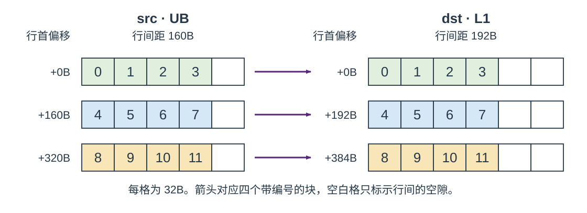
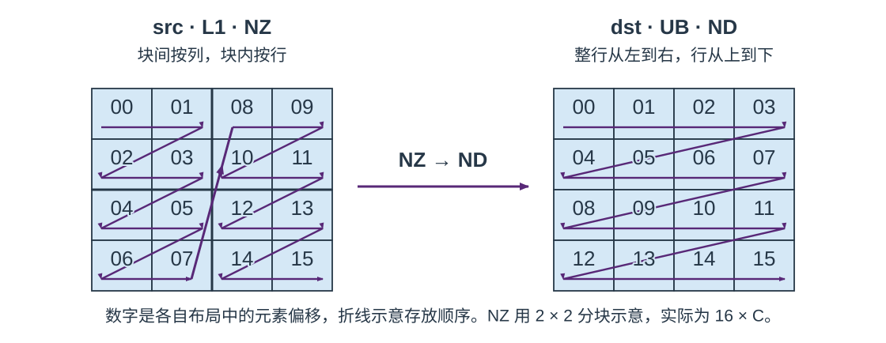
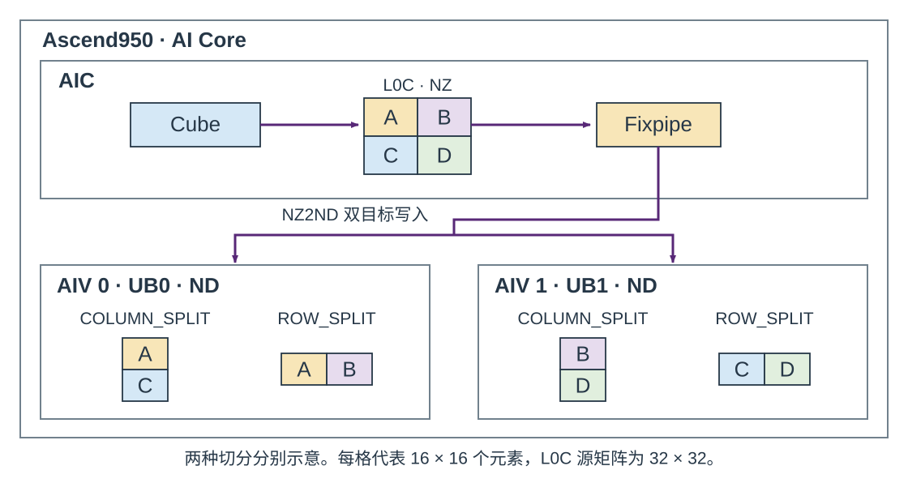

# Cube接口规格

[返回接口目录](../README.md)

以下 DMA、L0 搬运和填充约束面向 Ascend950（RegBase）。

<a name="api-tla-copy-ub-to-l1"></a>

## tla.copy_ub_to_l1

签名：`tla.copy_ub_to_l1(src, dst)`

返回：None。将源缓冲区中的元素复制到目标缓冲区，不改变元素值或顺序。

| 参数名 | 参数含义 | 参数类型 | 合法参数范围 | 其他约束 | 默认值 |
| --- | --- | --- | --- | --- | --- |
| `src` | 源缓冲区 | tla.buffer | UB；float16 / bfloat16 / float32 | 末维连续；有效起始地址、每行字节数及行间距按 32B 对齐。带行间距的二维搬运中，行间距不小于每行元素数，且不超过 `floor(65535 / A) × A` 个元素，其中 `A = 32 / sizeof(dtype)`。 | 必填 |
| `dst` | 目标缓冲区 | tla.buffer | L1；类型与 src 相同 | 形状与 src 相容；有效起始地址、每行字节数及行间距按 32B 对齐。带行间距的二维搬运中，行间距限制同 src。 | 必填 |

**约束**

- 地址：有效起始地址包含视图偏移；源、目的访问范围均不得超出各自分配。
- 长度：每行元素数须为 `32 / sizeof(dtype)` 的整数倍，例如 float16 为 16、float32 为 8；带行间距的二维搬运，行数不超过 8189。
- 步长：源、目的行间距须为 `32 / sizeof(dtype)` 的整数倍，且不小于每行元素数。
- 容量：含行间距的源、目的访问跨度分别不得超过实际可用 UB、L1 空间；不能仅按有效元素总数判断。
- 同步：多个 AIV 写共享 L1 时，目的范围不得重叠；AIV 写入后供 AIC 读取前须建立跨核同步。
- 填充：不提供 `pad_mode`、`pad_value`，不自动补齐非对齐数据。



将 UB 中的有效数据逐行复制到 L1，保持每行内的数据顺序。示例中每行搬运四个 `32B` 数据块，共 `128B`。源行步长为 `160B`，目的行步长为 `192B`，每一行分别按源和目的的步长定位。 [Ascend C API · asc_copy_ub2l1 图 2](https://asc.gitcode.com/api/SIMD-API/c_api/vector_datamove/asc_copy_ub2l1.html#功能说明)

**调用示例**

```python
@tla.jit
def example(src, dst):
    with tla.scope.vector():
        tla.copy_ub_to_l1(src, dst)
```

仓库测试：[tla_ut/dma/copy.py](https://github.com/triton-lang/triton-ascend/blob/074cf62907f815694a01e5cdc4ac78a90610ae82/third_party/ascend/unittest/tla_ut/dma/copy.py#L19)。

<a name="api-tla-copy-l1-to-ub"></a>

## tla.copy_l1_to_ub

签名：`tla.copy_l1_to_ub(src, dst)`

返回：None。将 L1 矩阵复制到 UB，目标按逻辑矩阵的行顺序存放。

| 参数名 | 参数含义 | 参数类型 | 合法参数范围 | 其他约束 | 默认值 |
| --- | --- | --- | --- | --- | --- |
| `src` | 源缓冲区 | tla.buffer | L1；float16 / bfloat16 / float32 | 完整矩阵分块，分块形状为 `(16, C)`，其中 `C = 32 / sizeof(dtype)`；块内步长为 `(C, 1)`（以元素计）。有效起始地址按 32B 对齐；允许外层块间留有间距，外层步长换算为字节后须按 32B 对齐，且各块不得重叠。 | 必填 |
| `dst` | 目标缓冲区 | tla.buffer | UB；与 src 类型相同 | 逻辑矩阵形状与 src 一致；末维连续，行间距不小于逻辑列数；有效起始地址及行间距换算为字节后按 32B 对齐。 | 必填 |

**约束**

- 地址：有效起始地址包含视图偏移；源、目的访问范围均不得超出各自分配。
- 长度：按完整分块搬运；源、目的有效元素数一致，不提供尾块填充。
- 容量：访问跨度（含偏移及行间距）不得超过各自实际分配和可用 L1、UB 空间。
- 同步：目标为 AIV sub-block 0 的 UB；AIC 发出跨核同步后，由该子块读取。



将 L1 中的矩阵搬到 UB，由块间按列排列、块内按行存放的 NZ 布局转换为逐行存放的 ND 布局。 [Ascend C 算子开发指南 · 数据格式](https://www.hiascend.com/doc_center/source/zh/canncommercial/900/programug/Ascendcopdevg/atlas_ascendc_10_0037.html)

**调用示例**

```python
@tla.jit
def example(src, dst):
    with tla.scope.cube():
        tla.copy_l1_to_ub(src, dst)
```

仓库测试：[tla_ut/dma/copy.py](https://github.com/triton-lang/triton-ascend/blob/074cf62907f815694a01e5cdc4ac78a90610ae82/third_party/ascend/unittest/tla_ut/dma/copy.py#L30)。

<a name="api-tla-copy-l1-to-bt"></a>

## tla.copy_l1_to_bt

**暂不开放。**

签名：`tla.copy_l1_to_bt(src, dst, params=None)`

- 当前不提供可用的参数组合。
- 本接口不列入待转测范围。

仓库 IR 构造用例：[tla_ut/dma/copy.py](https://github.com/triton-lang/triton-ascend/blob/074cf62907f815694a01e5cdc4ac78a90610ae82/third_party/ascend/unittest/tla_ut/dma/copy.py#L45)。

<a name="api-tla-copy-l1-to-fb"></a>

## tla.copy_l1_to_fb

**暂不开放。**

签名：`tla.copy_l1_to_fb(src, dst)`

- 当前调用抛出 `NotImplementedError`。
- 本接口不列入待转测范围。

<a name="api-tla-copy-l0c-to-ub"></a>

## tla.copy_l0c_to_ub

签名：`tla.copy_l0c_to_ub(src, dst, params=None)`

返回：None。将 L0C 累加结果写入目标缓冲区，可按参数选择数据重排、类型转换及激活。

| 参数名 | 参数含义 | 参数类型 | 合法参数范围 | 其他约束 | 默认值 |
| --- | --- | --- | --- | --- | --- |
| `src` | 累加结果 | tla.buffer | L0C；float32 | 四维分块，已初始化；NZ2NZ 时必须连续：以 B=16 为累加块宽，stride=(shape[1]*B*B,B*B,B,1)，不允许额外块间距。 | 必填 |
| `dst` | 目的 | tla.buffer | UB；float32 / float16 / bfloat16 | 仅直接分配或连续、零偏移的 reshape；不支持 subview、动态偏移或额外行间距；满足对齐也不放宽此限制。 | 必填 |
| `params` | 搬运配置 | tla.FixpipeL0C2UBParams / None | 下列配置字段 | None 使用下列字段的默认值。 | None |
| `params.dma_mode` | 目的布局 | tla.FixpipeDMAMode | NZ2ND：输出行顺序矩阵；NZ2DN：输出转置矩阵；NZ2NZ：保持分块存储 | 须与 dst 匹配；NZ2NZ 要求目的行块跨度 M_dst*C_dst≤65535 个元素，默认块宽 C_dst=16 时 M_dst≤4080。 | NZ2NZ |
| `params.pre_quant` | 类型转换 | tla.FixpipePreQuantMode | NO_QUANT：不转换；F322F16：float32 转 float16；F322BF16：float32 转 bfloat16 | 源为 float32；目的类型与转换模式对应，组合限制见下表。 | NO_QUANT |
| `params.pre_relu` | 激活 | tla.FixpipePreReluMode | NO_RELU：不激活；NORMAL_RELU：负值置零 | 与所选目的模式及类型转换的组合见下表。 | NO_RELU |
| `params.dual_dst_mode` | AIV 目的切分 | tla.FixpipeDualDstMode | NO_DUAL：完整写入单个 UB；ROW_SPLIT：两个 UB 各接收一半行；COLUMN_SPLIT：各接收一半列 | ROW_SPLIT 要求 M 可均分；COLUMN_SPLIT 要求 N 为 32 的倍数；与 dma_mode、sub_block_idx 的互斥见组合表。 | NO_DUAL |
| `params.sub_block_idx` | 单目标子块 | tla.FixpipeSubBlock / None | SUB_BLOCK_0：第一个 AIV 子块；SUB_BLOCK_1：第二个 AIV 子块；None：不单独选择 | 双目标必须显式设为 None，不能保留默认值。 | SUB_BLOCK_0 |

**约束**

- 长度：常规子集的 M、N 均为 16 的正整数倍且不超过 65520。

**组合限制（Ascend950，常规浮点子集）**

- 以下常规子集中，`pre_quant` 与目的元素类型必须一一对应：`NO_QUANT→FP32`、`F322F16→FP16`、`F322BF16→BF16`。以下组合均允许 `pre_relu=NO_RELU` 或 `NORMAL_RELU`。

| dma_mode | pre_quant | dual_dst_mode | sub_block_idx | 每个目的 UB 的形状 |
| --- | --- | --- | --- | --- |
| NZ2ND | NO_QUANT / F322F16 / F322BF16 | NO_DUAL | SUB_BLOCK_0 或 SUB_BLOCK_1 | 2D (M,N) |
| NZ2NZ | NO_QUANT / F322F16 / F322BF16 | NO_DUAL | SUB_BLOCK_0 或 SUB_BLOCK_1 | 与源相容的四维分块 |
| NZ2DN | NO_QUANT / F322F16 / F322BF16 | NO_DUAL | SUB_BLOCK_0 或 SUB_BLOCK_1 | 2D (N,M) |
| NZ2ND | NO_QUANT / F322F16 / F322BF16 | ROW_SPLIT | 必须显式 None | 2D (M/2,N) |
| NZ2ND | NO_QUANT / F322F16 / F322BF16 | COLUMN_SPLIT | 必须显式 None | 2D (M,N/2) |

- 容量：源、目的访问范围不得超出实际分配及各自可用容量。

- AIC 完成写入后必须建立跨核依赖，再由对应 AIV 子块读取。单目标仅由指定子块消费；双目标分别消费对应行分块或列分块。



同一 AI Core 内，Fixpipe 从 AIC 的 L0C 读取结果，写入两个 AIV 各自的 UB。`COLUMN_SPLIT` 向 UB0、UB1 分别写入左、右两半列，`ROW_SPLIT` 分别写入上、下两半行。两种切分的输出均为 ND。 [Ascend C API · 双目标模式](https://asc.gitcode.com/api/SIMD-API/basic_api/cube_compute_ISASI/cube_store_key_features/L0C_to_UB_dual_target_mode.html) · [Fixpipe 图 5](https://www.hiascend.com/doc_center/source/zh/CANNCommunityEdition/910beta2/API/ascendcopapi/atlasascendc_api_07_0251.html#ZH-CN_TOPIC_0000002587659358__fig8810182815117)

仓库测试：[tla_ut/cube/gemm_bias.py](https://github.com/triton-lang/triton-ascend/blob/074cf62907f815694a01e5cdc4ac78a90610ae82/third_party/ascend/unittest/tla_ut/cube/gemm_bias.py#L35)。

<a name="api-tla-copy-l0c-to-l1"></a>

## tla.copy_l0c_to_l1

签名：`tla.copy_l0c_to_l1(src, dst, params=None)`

返回：None。将 L0C 累加结果写入目标缓冲区，可按参数选择数据重排、类型转换及激活。

| 参数名 | 参数含义 | 参数类型 | 合法参数范围 | 其他约束 | 默认值 |
| --- | --- | --- | --- | --- | --- |
| `src` | 累加结果 | tla.buffer | L0C；float32 | 四维矩阵分块；不得读取未初始化累加器。 | 必填 |
| `dst` | 目的 | tla.buffer | L1；float32 / float16 / bfloat16 | 形状、布局与类型须符合本接口的组合限制。 | 必填 |
| `params` | 搬运配置 | tla.FixpipeL0C2L1Params / None | 下列配置字段 | None 使用下列字段的默认值。 | None |
| `params.dma_mode` | 目的布局 | tla.FixpipeDMAMode | NZ2ND：输出行顺序矩阵；NZ2DN：输出转置矩阵；NZ2NZ：保持分块存储 | 须与 dst 匹配；NZ2NZ 要求源、目的缓冲区连续，且目的行块跨度 M_dst*C_dst≤65535 个元素，默认块宽 C_dst=16 时 M_dst≤4080。 | NZ2NZ |
| `params.pre_quant` | 类型转换 | tla.FixpipePreQuantMode | NO_QUANT：不转换；F322F16：float32 转 float16；F322BF16：float32 转 bfloat16 | 源为 float32；目的类型与转换模式对应，组合限制见下表。 | NO_QUANT |
| `params.pre_relu` | 激活 | tla.FixpipePreReluMode | NO_RELU：不激活；NORMAL_RELU：负值置零 | 与所选目的模式及类型转换的组合见下表。 | NO_RELU |

**约束**

- 长度：常规子集的 M、N 均为 16 的正整数倍且不超过 65520。

**组合限制（Ascend950，常规浮点子集）**

- 以下常规子集中，`pre_quant` 与目的元素类型必须一一对应：`NO_QUANT→FP32`、`F322F16→FP16`、`F322BF16→BF16`。以下组合均允许 `pre_relu=NO_RELU` 或 `NORMAL_RELU`。

| dma_mode | pre_quant | 目的类型 | 目的形状 |
| --- | --- | --- | --- |
| NZ2ND | NO_QUANT / F322F16 / F322BF16 | FP32 / FP16 / BF16，按转换模式对应 | 2D (M,N) |
| NZ2NZ | NO_QUANT / F322F16 / F322BF16 | FP32 / FP16 / BF16，按转换模式对应 | 与源相容的四维分块 |
| NZ2DN | F322F16 / F322BF16 | 仅 FP16 / BF16 | 2D (N,M) |
| NZ2DN | NO_QUANT | FP32 | 不支持 |

- 本接口不提供 `dual_dst_mode` 或 `sub_block_idx`；不支持的类型组合见表。

- 容量：源、目的访问范围不得超过实际分配及各自可用容量。
- 数据顺序：行顺序或转置输出若供分块输入使用，须先重排；修改视图不改变数据顺序。
- 同步：写入完成后才能读取，复用前须保证先前消费者完成。

**L1 输出与后续输入的组合限制**

| dma_mode | pre_quant / 目的类型 | 配置 | 输出及后续使用约束 |
| --- | --- | --- | --- |
| NZ2NZ | NO_QUANT / float32 | 默认 | 输出块宽 C_out=16；形状为 (N/C_out,M/16,16,C_out)。后续矩阵输入要求 C_in=32/sizeof(dtype)，此时为 8；必须先重排数据，reshape 不能代替转换。 |

仓库测试：[tla_ut/dma/fixpipe.py](https://github.com/triton-lang/triton-ascend/blob/074cf62907f815694a01e5cdc4ac78a90610ae82/third_party/ascend/unittest/tla_ut/dma/fixpipe.py#L69)。

<a name="api-tla-store-l0c-to-gm"></a>

## tla.store_l0c_to_gm

签名：`tla.store_l0c_to_gm(src, dst, params=None)`

返回：None。将 L0C 累加结果写入目标缓冲区，可按参数选择数据重排、类型转换及激活。

| 参数名 | 参数含义 | 参数类型 | 合法参数范围 | 其他约束 | 默认值 |
| --- | --- | --- | --- | --- | --- |
| `src` | 累加结果 | tla.buffer | L0C；float32 | 四维矩阵分块；不得读取未初始化累加器。 | 必填 |
| `dst` | 目的 | tla.buffer | GM；float32 / float16 / bfloat16 | 形状、布局与类型须符合本接口的组合限制。 | 必填 |
| `params` | 搬运配置 | tla.FixpipeL0C2GMParams / None | 下列配置字段 | None 使用下列字段的默认值。 | None |
| `params.dma_mode` | 目的布局 | tla.FixpipeDMAMode | NZ2ND：输出行顺序矩阵；NZ2DN：输出转置矩阵；NZ2NZ：保持分块存储 | 须与 dst 匹配；NZ2NZ 要求源、目的缓冲区连续，且目的行块跨度 M_dst*C_dst≤65535 个元素，默认块宽 C_dst=16 时 M_dst≤4080。 | NZ2NZ |
| `params.pre_quant` | 类型转换 | tla.FixpipePreQuantMode | NO_QUANT：不转换；F322F16：float32 转 float16；F322BF16：float32 转 bfloat16 | 源为 float32；目的类型与转换模式对应，组合限制见下表。 | NO_QUANT |
| `params.pre_relu` | 激活 | tla.FixpipePreReluMode | NO_RELU：不激活；NORMAL_RELU：负值置零 | 与所选目的模式及类型转换的组合见下表。 | NO_RELU |

**约束**

- 长度：常规子集的 M、N 均为 16 的正整数倍且不超过 65520。

**组合限制（Ascend950，常规浮点子集）**

- 以下常规子集中，`pre_quant` 与目的元素类型必须一一对应：`NO_QUANT→FP32`、`F322F16→FP16`、`F322BF16→BF16`。以下组合均允许 `pre_relu=NO_RELU` 或 `NORMAL_RELU`。

| dma_mode | pre_quant | 目的类型 | 目的形状 |
| --- | --- | --- | --- |
| NZ2ND | NO_QUANT / F322F16 / F322BF16 | FP32 / FP16 / BF16，按转换模式对应 | 2D (M,N) |
| NZ2NZ | NO_QUANT / F322F16 / F322BF16 | FP32 / FP16 / BF16，按转换模式对应 | 与源相容的四维分块 |
| NZ2DN | NO_QUANT / F322F16 / F322BF16 | FP32 / FP16 / BF16，按转换模式对应 | 2D (N,M) |

- 容量：源、目的访问范围不得超出实际分配及各自可用容量。
- 同步：搬运完成前不得改写源累加器，写入完成后才能读取目的。
- 目标选择：本接口不提供 `dual_dst_mode` 或 `sub_block_idx`。

仓库测试：[tla_ut/cube/allocation.py](https://github.com/triton-lang/triton-ascend/blob/074cf62907f815694a01e5cdc4ac78a90610ae82/third_party/ascend/unittest/tla_ut/cube/allocation.py#L47)。

<a name="api-tla-cube-mmad-mx"></a>

## tla.cube.mmad_mx

签名：`tla.cube.mmad_mx(a, b, scale_a, scale_b, acc, *, format_a=None, format_b=None, transpose_a=False, transpose_b=False, clear_accum=False, bias=None, real_m=None, real_k=None, real_n=None)`

返回：None。

编译表示：hivm.hir.mmadmxL1。

| 参数名 | 参数含义 | 参数类型 | 合法参数范围 | 其他约束 | 默认值 |
| --- | --- | --- | --- | --- | --- |
| `a` | 第一个操作数 | tla.buffer | 地址空间：L1<br>数据类型：<br>B8：float8e4m3fn / float8e5m2 / int8 / uint8<br>B16：不支持<br>B32：不支持<br>B64：不支持 | 元素按 FP8 格式或 packed E2M1 解读。双边须同为 FP4 或同为 FP8。 采用逻辑 2D 或物理 4D NZ。 | 必填 |
| `b` | 第二个操作数 | tla.buffer | 地址空间：L1<br>数据类型：<br>B8：float8e4m3fn / float8e5m2 / int8 / uint8<br>B16：不支持<br>B32：不支持<br>B64：不支持 | 元素按 FP8 格式或 packed E2M1 解读。双边须同为 FP4 或同为 FP8。 采用逻辑 2D 或物理 4D NZ。 | 必填 |
| `scale_a` | A 的 E8M0 块缩放表 | tla.buffer | 地址空间：L1<br>数据类型：int8 / uint8（E8M0 编码） | 每 32 个逻辑 K 取一个因子，逻辑形状 (M, K/32)。4D zZ/nN 的奇数组数对齐到偶数。 | 必填 |
| `scale_b` | B 的 E8M0 块缩放表 | tla.buffer | 地址空间：L1<br>数据类型：int8 / uint8（E8M0 编码） | 每 32 个逻辑 K 取一个因子，逻辑形状 (N, K/32)。4D zZ/nN 的奇数组数对齐到偶数。 | 必填 |
| `acc` | 累加器 | tla.buffer | 地址空间：L0C<br>数据类型：<br>B8：不支持<br>B16：不支持<br>B32：float32<br>B64：不支持 | 逻辑形状须等于 (real_m, real_n)。clear_accum=False 时读取已有累加值。 | 必填 |
| `format_a` | A 的 MX 编码格式 | tla.MxFormat 或 None | None / E5M2 / E4M3 / E2M1 | None 仅能从带类型的 FP8 推断。E2M1 每字节装两个值。 | None |
| `format_b` | B 的 MX 编码格式 | tla.MxFormat 或 None | None / E5M2 / E4M3 / E2M1 | None 仅能从带类型的 FP8 推断。E2M1 每字节装两个值。 | None |
| `transpose_a` | 是否在乘法的逻辑索引中转置 A | 编译期 bool | False / True | 转置后须满足逻辑形状。 | False |
| `transpose_b` | 是否在乘法的逻辑索引中转置 B | 编译期 bool | False / True | 转置后须满足逻辑形状。 | False |
| `clear_accum` | 是否从零开始计算 | 编译期 bool | False / True | 为 True 时从零开始，False 累加到已有值。 | False |
| `bias` | 可选的逐通道偏置 | tla.buffer 或 None | None 或 L1 buffer<br>数据类型：同 acc | 形状 (N,)、(1,N) 或等价 4D zN。 | None |
| `real_m` | 实际计算的 M 维长度 | 编译期 int 或 None | None 或 16 的正整数倍，不超过对应 tile 维度 | None 使用全长。 | None |
| `real_k` | 实际使用的 K 维长度 | 编译期 int 或 None | None 或 16 的正整数倍，不超过对应 tile 维度 | None 使用全长。MX 的 packed FP4 real_k 用字节计，逻辑 K 按每字节两个值计算。 | None |
| `real_n` | 实际计算的 N 维长度 | 编译期 int 或 None | None 或 16 的正整数倍，不超过对应 tile 维度 | None 使用全长。 | None |

**调用示例**

Ascend950PR。输入为布局相容的 FP8 L1 tile，缩放表为 E8M0，累加缓冲区为 float32 L0C。

```python
@tla.jit
def example(a_l1, b_l1, scale_a, scale_b, acc_l0c):
    with tla.scope.cube():
        tla.cube.mmad_mx(a_l1, b_l1, scale_a, scale_b, acc_l0c, clear_accum=True)
```

<a name="api-tla-scope-cube"></a>

## tla.scope.cube

签名：`tla.scope.cube()`

返回：无独立返回值。通过 with 声明内核区域。

将区域标记为 Cube 核模式。区域之间的跨核数据交接需要显式同步。

**调用示例**

```python
@tla.jit
def example(a_l1, b_l1, acc_l0c):
    with tla.scope.cube():
        tla.cube.mmad(a_l1, b_l1, acc_l0c, clear_accum=True)
```

仓库测试：[tla_ut/dma/ctrl.py](https://github.com/triton-lang/triton-ascend/blob/074cf62907f815694a01e5cdc4ac78a90610ae82/third_party/ascend/unittest/tla_ut/dma/ctrl.py#L19)。

<a name="api-tla-cube-mmad"></a>

## tla.cube.mmad

签名：`tla.cube.mmad(a, b, acc, transpose_a=False, transpose_b=False, clear_accum=False, *, real_m=None, real_k=None, real_n=None)`

返回：None。

编译表示：hivm.hir.mmadL1。

| 参数名 | 参数含义 | 参数类型 | 合法参数范围 | 其他约束 | 默认值 |
| --- | --- | --- | --- | --- | --- |
| `a` | 第一个操作数 | tla.buffer | 地址空间：L1<br>数据类型：已确认 float16 / bfloat16 / float32 / int8 的常规签名，详见其他约束 | a/b 元素类型相同，转置后的 K 相等。浮点输入累加到 float32，常规 int8 输入累加到 int32。 采用逻辑 2D 或物理 4D NZ。 | 必填 |
| `b` | 第二个操作数 | tla.buffer | 地址空间：L1<br>数据类型：已确认 float16 / bfloat16 / float32 / int8 的常规签名，详见其他约束 | a/b 元素类型相同，转置后的 K 相等。浮点输入累加到 float32，常规 int8 输入累加到 int32。 采用逻辑 2D 或物理 4D NZ。 | 必填 |
| `acc` | 累加器 | tla.buffer | 地址空间：L0C<br>数据类型：<br>B8：不支持<br>B16：不支持<br>B32：int32 / float32<br>B64：不支持 | 逻辑形状须等于 (real_m, real_n)。clear_accum=False 时读取已有累加值。 | 必填 |
| `transpose_a` | 是否在乘法的逻辑索引中转置 A | 编译期 bool | False / True | 转置后须满足逻辑形状。 | False |
| `transpose_b` | 是否在乘法的逻辑索引中转置 B | 编译期 bool | False / True | 转置后须满足逻辑形状。 | False |
| `clear_accum` | 是否从零开始计算 | 编译期 bool | False / True | 为 True 时从零开始，False 累加到已有值。 | False |
| `real_m` | 实际计算的 M 维长度 | 编译期 int 或 None | None 或 16 的正整数倍，不超过对应 tile 维度 | None 使用全长。 | None |
| `real_k` | 实际使用的 K 维长度 | 编译期 int 或 None | None 或 16 的正整数倍，不超过对应 tile 维度 | None 使用全长。 | None |
| `real_n` | 实际计算的 N 维长度 | 编译期 int 或 None | None 或 16 的正整数倍，不超过对应 tile 维度 | None 使用全长。 | None |

**调用示例**

A、B 为布局相容的 L1 tile，例如 float16 输入，acc 为 float32 L0C。

```python
@tla.jit
def example(a_l1, b_l1, acc_l0c):
    with tla.scope.cube():
        tla.cube.mmad(a_l1, b_l1, acc_l0c, clear_accum=True)
```

仓库测试：[tla_ut/cube/gemm_bias.py](https://github.com/triton-lang/triton-ascend/blob/074cf62907f815694a01e5cdc4ac78a90610ae82/third_party/ascend/unittest/tla_ut/cube/gemm_bias.py#L34)。

<a name="api-tla-set-ctrl"></a>

## tla.set_ctrl

签名：`tla.set_ctrl(enable, idx)`

返回：None。

编译表示：hivm.hir.set_ctrl。

| 参数名 | 参数含义 | 参数类型 | 合法参数范围 | 其他约束 | 默认值 |
| --- | --- | --- | --- | --- | --- |
| `enable` | 是否置位 | 编译期 bool | False / True | — | 必填 |
| `idx` | CTRL bit 索引 | 编译期 int | 0 至 63（64 位 CTRL 的 bit 索引） | 仅使用目标定义的位。不会自动恢复状态。 | 必填 |

**调用示例**

示例为当前表中记录的 RegBase HF32 位。

```python
@tla.jit
def example():
    with tla.scope.cube():
        tla.set_ctrl(True, 46)
```

仓库测试：[tla_ut/dma/ctrl.py](https://github.com/triton-lang/triton-ascend/blob/074cf62907f815694a01e5cdc4ac78a90610ae82/third_party/ascend/unittest/tla_ut/dma/ctrl.py#L20)。
